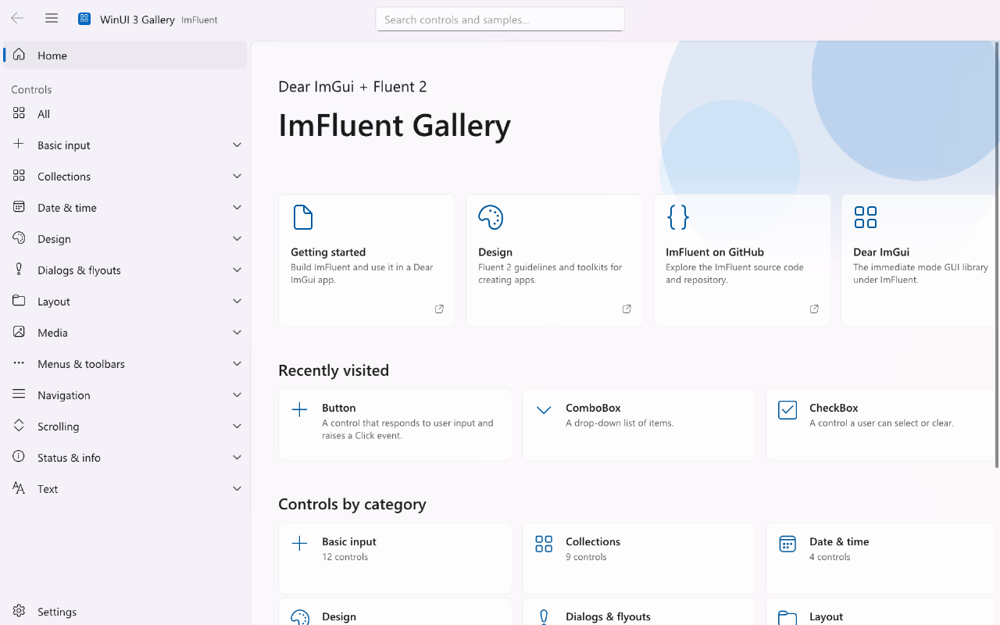
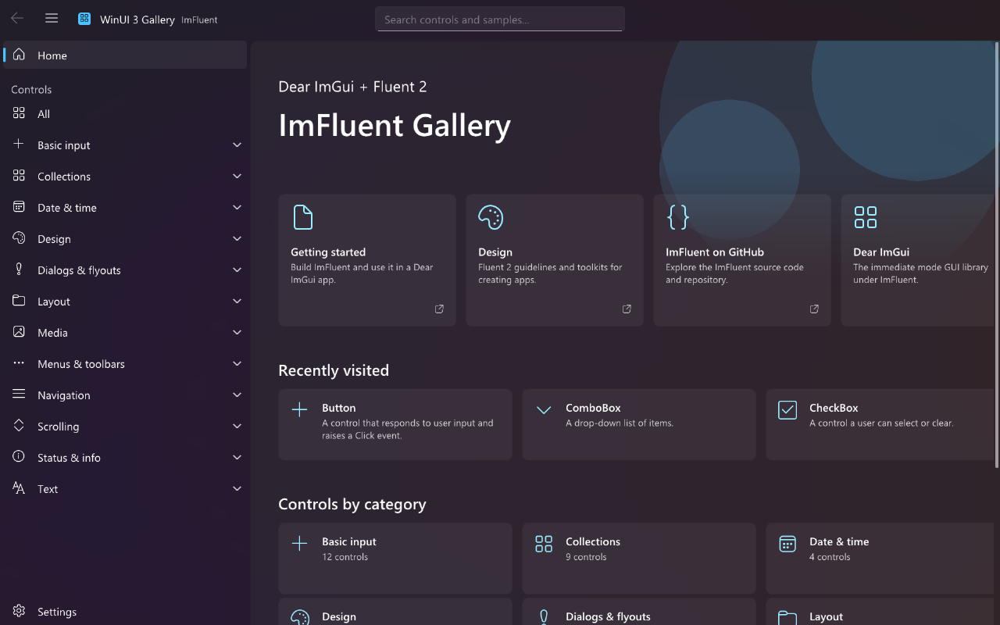
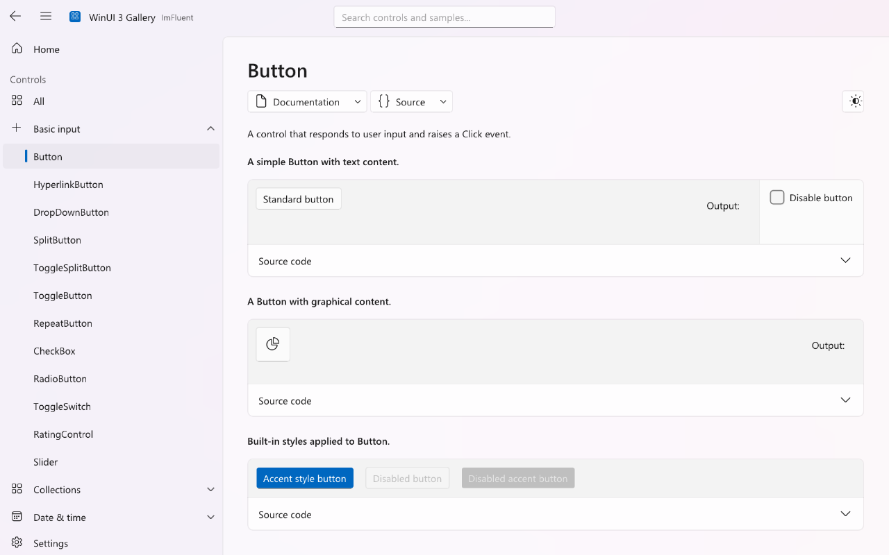
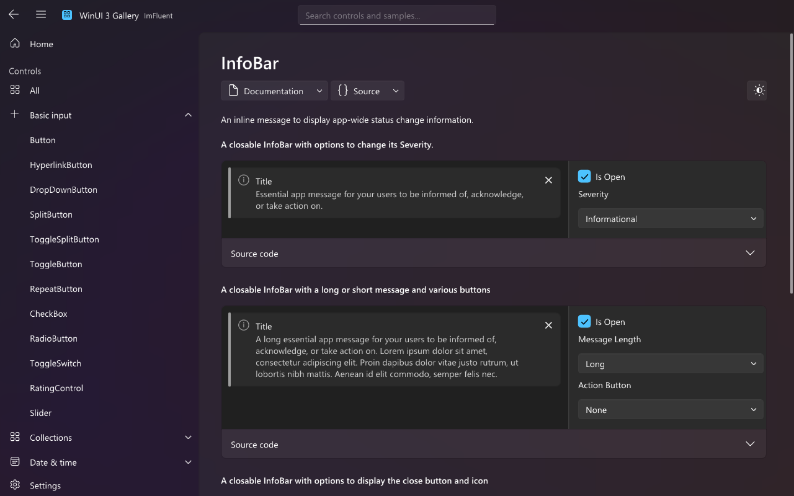
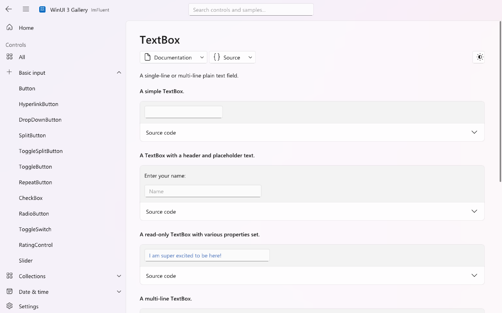
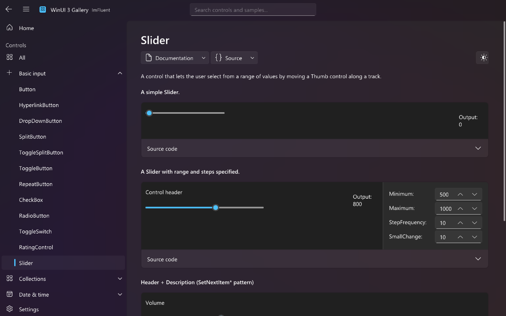

# ImFluent

Widgets for [Dear ImGui](https://github.com/ocornut/imgui) that follow Microsoft's
[Fluent 2](https://fluent2.microsoft.design/) design system and look and behave like WinUI 3 controls.

<p>


</p>

- 63 WinUI controls: buttons, toggles, sliders, text and number boxes, pickers, lists, trees, tabs,
  navigation view, command bars, menus, flyouts, dialogs, info bars and more.
- Light, dark and high-contrast themes with the WinUI colour values, the Segoe UI type ramp and Fluent icons.
- Keyboard-only use everywhere, with WinUI focus and arrow-key behaviour.
- Mica and Mica Alt window backdrops from the desktop wallpaper, on any renderer (screenshots use Mica).
- `ImFluent::ShowDemoWindow()`: a gallery modelled on the WinUI 3 Gallery, one page per control.

| | |
|---|---|
|  |  |
|  |  |

## Use

```cpp
#include "imfluent.h"

ImFluent::LoadFluentSystemFonts();
ImFluent::SetThemePreset(ImFluentThemePreset_Dark);

// every frame, between ImGui::NewFrame() and ImGui::Render()
if (ImFluent::AccentButton("Sign in")) { /* ... */ }

static bool wifi = true;
ImFluent::ToggleSwitch("Wi-Fi", &wifi);

ImFluent::ShowDemoWindow();
```

Define `IMFLUENT_DISABLE_DEMO_WINDOWS` to compile out the gallery.

Without Segoe UI (macOS, Linux), `LoadFluentSystemFonts()` uses a common UI font and no icons.
Pass your own files with `ImFluent::LoadFluentFonts(regular, semibold, icons)`.

## Mica backdrop

ImFluent blurs and tints the desktop wallpaper into a small texture and draws it behind your windows, as Windows 11
Mica does. Platform hooks find the wallpaper and the window position; compile the backend for your platform from
`src/backends`, like a Dear ImGui backend:

```cpp
#include "backends/imfluent_backdrop_win32.h" // _osx.h on macOS; _linux.h and _sdl3.h on Linux

ImFluent_ImplWin32_InstallBackdropHooks();    // ImFluent_ImplOSX_..., or ImFluent_ImplLinux_... + ImFluent_ImplSDL3_InstallBackdropScreenRects()
ImFluent::SetBackdrop(ImFluentBackdrop_Mica);

// every frame, after ImGui::NewFrame(); give your root window ImGuiWindowFlags_NoBackground
ImFluent::RenderBackdrop();
```

The macOS and Linux backends have not run on those systems yet (the Linux one is compile-checked).

## Build

ImFluent is one static library (`ImFluent::ImFluent`) on top of `imgui`, built with CMake and vcpkg
(`VCPKG_ROOT` must point at your vcpkg):

```
cmake --preset configure-win64
cmake --build --preset win64-debug
```

The `examples` vcpkg feature builds `ImFluentGallery` (SDL3 + SDL_GPU). The `test-engine` feature adds the
automation described below.

## Keyboard

Composite controls (RadioButtons, ListView, SelectorBar, NavigationView, TabView, ...) are one Tab stop,
arrows move inside them, and popups close with Escape and give focus back to their owner. Put `ListViewItem`,
`GridViewItem` and `TreeNode` rows between `BeginListView` / `BeginGridView` / `BeginTreeView` and the matching
`End` call to make the list one Tab stop too.

Command shortcuts are key chords in `ImFluentActions`, with WinUI defaults. Change one, or set it to 0 to turn
it off:

```cpp
ImFluentActions & actions = ImFluent::GetActions();
actions.RevealPassword    = ImGuiMod_Ctrl | ImGuiKey_R; // default Alt+F8
actions.TogglePopup       = 0;                          // no F4 for ComboBox and SplitButton
```

## Automation and tests

With the `test-engine` feature, `ImFluentGallery` runs the
[Dear ImGui Test Engine](https://github.com/ocornut/imgui_test_engine) regression tests and serves an MCP
server. The Test Engine has its own license; the ImFluent library does not depend on it.

```
ImFluentGallery                      # MCP server on http://127.0.0.1:7801/mcp
ImFluentGallery --run-tests [filter] # run the tests, exit code = failed tests
ImFluentGallery --hidden             # no window: renders offscreen, MCP and screenshots still work
```

Automation injects input into Dear ImGui only: it never moves the OS mouse or takes OS focus.
`tools/winui_mcp` drives the real WinUI 3 Gallery with the same tools (`goto_page`, `screenshot`, `click`,
`key`, ...), so a page can be compared side by side; `tools/mcp_call.py` calls a tool from the command line:

```
python tools/mcp_call.py goto_page '{"page":"ComboBox"}'
python tools/mcp_call.py screenshot '{"scale":0.5}' --out combo.png
```

## License

MIT, see [LICENSE](LICENSE).
